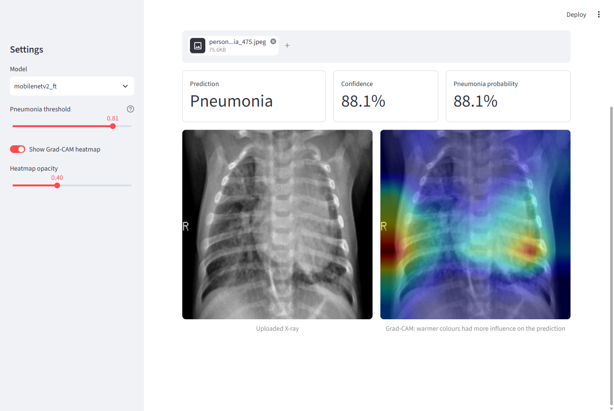
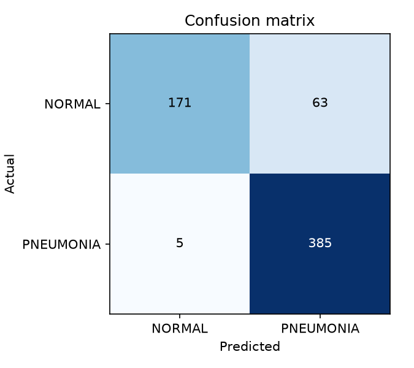
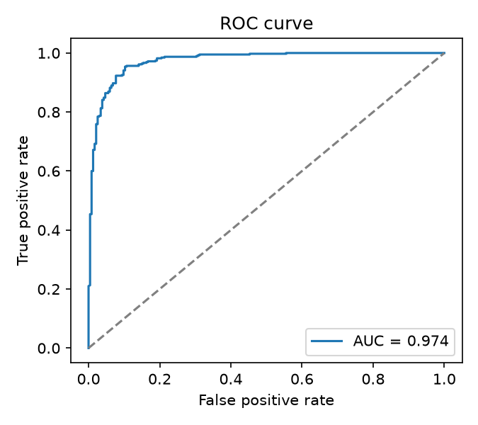
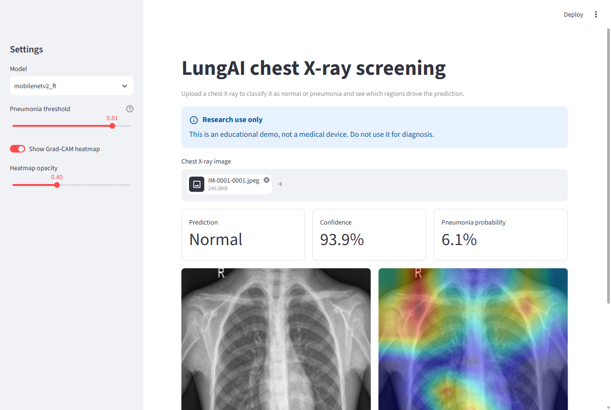

# LungAI: Chest X-Ray Pneumonia Classification

[](https://github.com/Lingesh-S/xray-diagnosis-cnn/actions/workflows/ci.yml)


An end-to-end deep learning project that classifies pediatric chest X-rays as **NORMAL** or
**PNEUMONIA** with a convolutional neural network, explains each prediction with **Grad-CAM**
heatmaps, and serves the model through a **Streamlit** web app.

> **Research use only.** This is an educational project, not a medical device. Do not use it to
> diagnose real patients.



## Results

MobileNetV2 (ImageNet weights) evaluated on the **624-image official test set**, which is never
used for training, model selection or threshold tuning:

| Model | Threshold | Accuracy | Pneumonia recall | Specificity | Precision | F1 | ROC-AUC |
|---|---|---|---|---|---|---|---|
| Frozen backbone | 0.50 | 83.8% | 99.0% | 58.5% | 79.9% | 0.884 | 0.967 |
| Frozen backbone | 0.72 (tuned on val) | 87.0% | 98.2% | 68.4% | 83.8% | 0.904 | 0.967 |
| **Fine-tuned (last 40 layers)** | **0.81 (tuned on val)** | **89.1%** | **98.7%** | **73.1%** | **85.9%** | **0.919** | **0.974** |

| Confusion matrix (fine-tuned) | ROC curve |
|---|---|
|  |  |

**What the numbers say**
- The model catches almost every pneumonia case (385 of 390), which is the error that matters most
  for screening.
- Most mistakes are normal X-rays flagged as pneumonia (63 of 234). The official test images come
  from a different distribution than the training images; validation accuracy was about 97% while
  test accuracy is 89%.
- The decision threshold is picked on the validation split by maximising sensitivity + specificity,
  then saved next to the model so the CLI and the app use it by default.

See the [model card](docs/model_card.md) for data, intended use and limitations.

## Features

- **Data pipeline**: deterministic, stratified train/validation re-split (the official validation
  folder has only 16 images), balanced class weights and light augmentation.
- **Models**: a custom 4-block CNN baseline plus MobileNetV2 and EfficientNetB0 transfer learning,
  with an optional fine-tuning stage.
- **Evaluation**: accuracy, precision, recall, specificity, F1, ROC-AUC, confusion matrix and ROC
  curve, with validation-based threshold tuning.
- **Explainability**: Grad-CAM heatmaps for every supported model.
- **Web app**: upload an X-ray, see the prediction, confidence and heatmap, adjust the threshold.
- **Quality**: 30 pytest tests, ruff lint and format checks, GitHub Actions CI on every pull request.

## Quick start

```bash
git clone https://github.com/Lingesh-S/xray-diagnosis-cnn.git
cd xray-diagnosis-cnn
python -m venv .venv
.venv\Scripts\activate          # Windows; use `source .venv/bin/activate` on macOS/Linux
pip install -r requirements.txt
pip install -e .
```

### 1. Get the data

Create a Kaggle API token (Kaggle → Settings → API) and save it in `~/.kaggle/`, then:

```bash
python scripts/download_data.py
```

This copies the [Chest X-Ray Images (Pneumonia)](https://www.kaggle.com/datasets/paultimothymooney/chest-xray-pneumonia)
dataset into `data/chest_xray/` (about 2.3 GB download).

### 2. Train

```bash
# Stage 1: train the classification head on a frozen MobileNetV2
python -m lungai.train --model mobilenetv2

# Stage 2: fine-tune the last 40 backbone layers with a small learning rate
python -m lungai.train --model mobilenetv2 --init-from models/mobilenetv2.keras \
    --fine-tune-layers 40 --learning-rate 1e-5 --epochs 10 --run-name mobilenetv2_ft
```

On a laptop CPU, stage 1 takes about an hour (20 epochs) and stage 2 about 15 minutes (10 epochs).
All hyper-parameters live in [`configs/config.yaml`](configs/config.yaml).

### 3. Evaluate

```bash
python -m lungai.evaluate --model-path models/mobilenetv2_ft.keras --tune-threshold
```

Writes `metrics.json`, `confusion_matrix.png` and `roc_curve.png` to `reports/` and saves the tuned
threshold to `models/mobilenetv2_ft_threshold.json`.

### 4. Predict a single image

```bash
python -m lungai.predict path/to/xray.jpeg --model-path models/mobilenetv2_ft.keras --gradcam heatmap.png
```

### 5. Run the web app

```bash
streamlit run streamlit_app.py
```

The app lists every model in `models/`, preselects the newest one and starts from its tuned
threshold.



## Project structure

```
xray-diagnosis-cnn/
├── configs/config.yaml        # hyper-parameters and paths
├── src/lungai/
│   ├── data.py                # discovery, splitting, tf.data pipelines, augmentation
│   ├── model.py               # custom CNN and transfer-learning builders
│   ├── train.py               # training and fine-tuning entry point
│   ├── evaluate.py            # metrics, plots, threshold tuning
│   ├── thresholds.py          # save/load tuned thresholds
│   ├── gradcam.py             # Grad-CAM heatmaps
│   └── predict.py             # single-image inference CLI
├── scripts/download_data.py   # Kaggle download helper
├── streamlit_app.py           # web demo
├── tests/                     # pytest suite (synthetic data, no download needed)
├── docs/                      # model card, progress notes, images
└── .github/workflows/ci.yml   # lint and tests on every PR
```

## Development

```bash
pytest -q              # run the test suite
ruff check .           # lint
ruff format .          # format
```

Project goals and the roadmap are in [GOALS.md](GOALS.md); progress notes are in
[docs/progress/](docs/progress/).

## Tech stack

Python, TensorFlow/Keras, NumPy, scikit-learn, Matplotlib, Streamlit, pytest, ruff, GitHub Actions.

## License

MIT, see [LICENSE](LICENSE).

## Author

**Lingesh S** · [GitHub](https://github.com/Lingesh-S) · [LinkedIn](https://linkedin.com/in/lingesh-s29)
